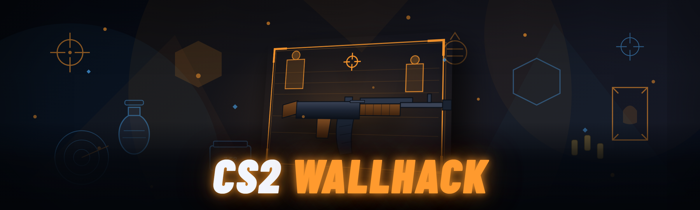

  
  
  

  

  
  
  

---

CS2 wallhack overlay: enemy ESP boxes, skeleton chams, visibility check, team-color radar. External injector, no VAC bypass claims.

## Overview

CS2 wallhack overlay: enemy ESP boxes, skeleton chams, visibility check, team-color radar. External injector, no VAC bypass claims.

  

## License

[MIT License](LICENSE)

  

